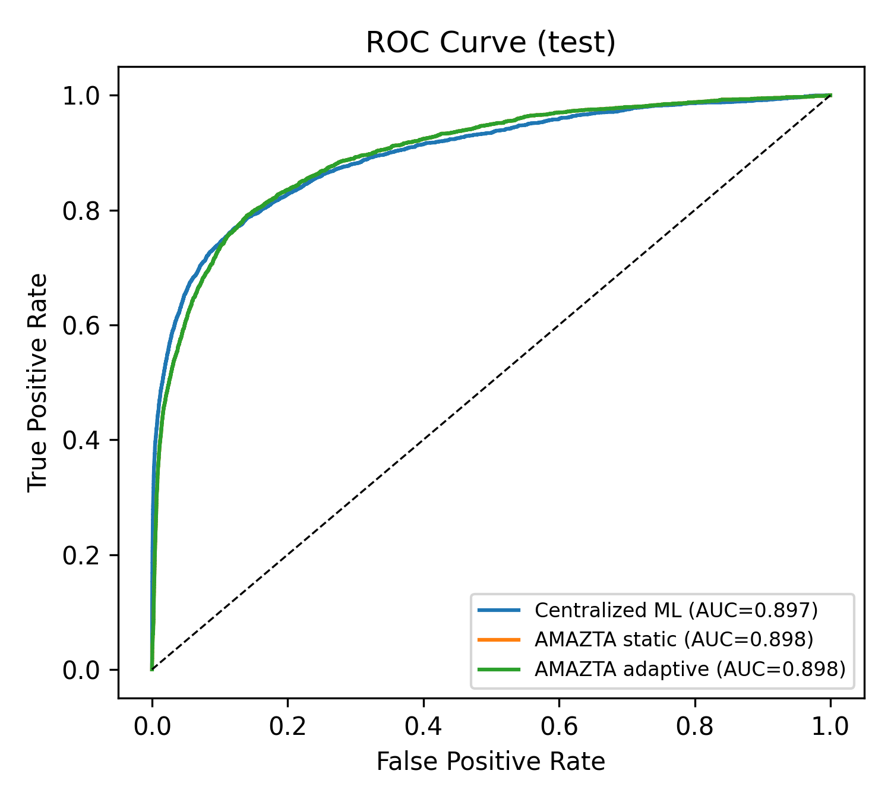
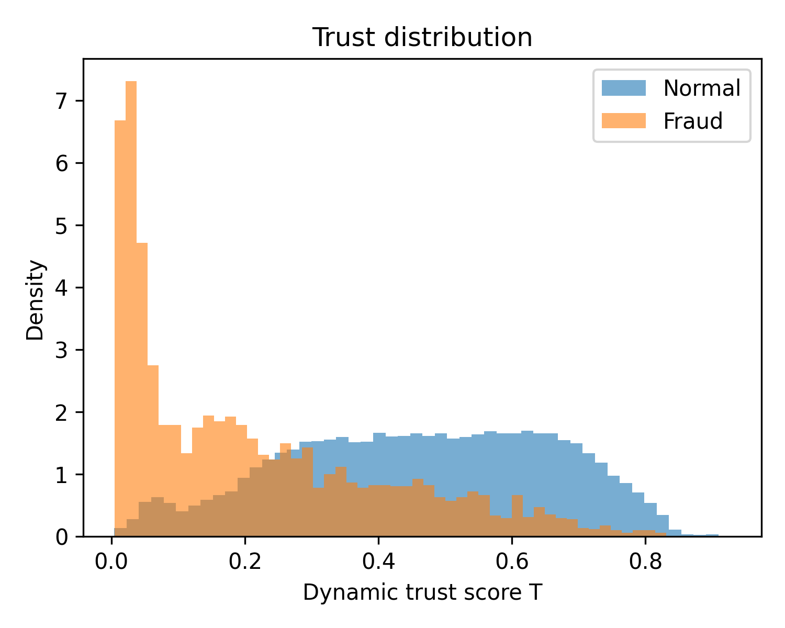

# AMAZTA: Adaptive Multi-Agent Zero Trust Architecture

Implementation and experimental results for **AMAZTA**, an adaptive multi-agent Zero Trust architecture for autonomous risk assessment and response in critical infrastructure. Each incoming access request (here, a financial transaction) is evaluated by several specialized agents, combined into a trust score and a risk score, and mapped to a graded Zero Trust action: **Allow, Restrict, Deny or Isolate**.

The complete pipeline runs in a single Google Colab notebook on the free tier (T4 GPU), with automatic data download and step-by-step checkpointing.

## Architecture

| Agent | Role | Model |
| --- | --- | --- |
| Identity Agent | Identity trust from card, address, email and identity features | XGBoost |
| Device Trust Agent | Device trust from device type, OS, browser and identity-record presence | XGBoost |
| Behavioral Monitoring Agent | Anomaly score from transaction behavior | Autoencoder (PyTorch), trained on normal transactions only |
| Threat Detection Agent | Overall attack/fraud level from all features | XGBoost (GPU) |
| Context Agent | Contextual risk from product type, time and distance | Smoothed historical fraud rates |
| Vulnerability check | Missing identity/device information | Rule-based |
| Risk Assessment, Policy Decision, Response and Coordination | Trust/risk fusion, dynamic trust update and policy actions | Formulas below |

**Trust score:** `T = wI·I + wD·D + wB·B + wC·C`

**Risk score:** `R = wT·(1 − T) + wA·A + wV·V + wB·Ba + wC′·C′`

**Dynamic trust update:** `T(t+1) = α·T(t) + (1 − α)·E(t)`, tracked per entity (card1 + addr1)

**Policy:** Isolate if `R ≥ θD` and `T < θI`; Deny if `R ≥ θD`; Restrict (step-up verification) if `R ≥ θR` or `T < θT`; otherwise Allow.

All weights, α and thresholds are selected on the validation set only.

## Datasets

The datasets are **not included** in this repository. The notebook downloads them automatically from Kaggle.

| Dataset | Use | Source |
| --- | --- | --- |
| IEEE-CIS Fraud Detection | Main evaluation (590,540 labeled transactions, 3.5% fraud) | https://www.kaggle.com/competitions/ieee-fraud-detection |
| Transaction Data for Banking Operations | Case study only (1,000 synthetic transactions) | https://www.kaggle.com/datasets/ziya07/transaction-data-for-banking-operations |

The IEEE-CIS data is split chronologically: 70% training (413,378), 15% validation (88,581) and 15% test (88,581, of which 3,083 are fraudulent).

## Repository structure

```
.
├── AMAZTA_ZeroTrust_Implementation.ipynb   # complete pipeline (Google Colab), with outputs
├── requirements.txt                        # package versions used for the reported results
├── results/
│   ├── main_results.csv                    # detection performance vs. baselines (test set)
│   ├── action_distribution.csv             # Allow / Restrict / Deny / Isolate counts
│   ├── ablation.csv                        # agent-removal ablation study
│   ├── scalability.csv                     # throughput for 100–50,000 requests
│   ├── latency.json                        # single-request latency (mean, median, p95)
│   ├── fusion.json                         # learned weights, alpha search and thresholds
│   ├── feature_groups.json                 # features assigned to each agent
│   ├── case_study_ziya07.json              # case-study summary
│   └── case_study_ziya07_decisions.csv     # case-study decisions (IDs, label, trust, risk, action)
├── figures/                                # all figures at 300 dpi
└── logs/
    ├── run_log.txt                         # log of the reported run
    └── training_state.json                 # per-step status and training histories
```

## How to run

1. Open `AMAZTA_ZeroTrust_Implementation.ipynb` in Google Colab.
2. Join the Kaggle competition and accept its rules: https://www.kaggle.com/competitions/ieee-fraud-detection/rules
3. Create a Kaggle API credential (Kaggle → Settings → API → Create New Token) and add it to **Colab Secrets** as `KAGGLE_API_TOKEN` (or `KAGGLE_USERNAME` + `KAGGLE_KEY`), with notebook access enabled. Alternatively, upload `kaggle.json` when Cell 3 asks for it.
4. Select **Runtime → Change runtime type → T4 GPU**, then **Runtime → Run all**.

All intermediate data, models and results are saved to `MyDrive/AMAZTA` on Google Drive. If the session disconnects, run all cells again: completed steps are skipped and training resumes from the last checkpoint. A full run takes about 1–2 hours on the free tier.

Never commit a Kaggle token or `kaggle.json` to a repository.

## Environment

| Component | Version |
| --- | --- |
| Python | 3.13.15 |
| XGBoost | 3.4.1 |
| PyTorch | 2.11.0 (CUDA 13.0) |
| scikit-learn | 1.6.1 |
| pandas | 2.2.3 |
| NumPy | 2.1.3 |
| Hardware | Google Colab, NVIDIA Tesla T4 (15 GB), 12 GB RAM |

Random seed: 42.

## Results (IEEE-CIS test set, 88,581 transactions)

| Model | Accuracy | Precision | Recall | F1 | FPR | ROC-AUC | PR-AUC |
| --- | --- | --- | --- | --- | --- | --- | --- |
| Static rule-based Zero Trust (no ML) | 0.953 | 0.031 | 0.012 | 0.017 | 0.013 | 0.373 | 0.031 |
| Centralized single ML (XGBoost) | 0.970 | 0.576 | 0.486 | 0.527 | 0.013 | 0.897 | 0.544 |
| AMAZTA (proposed) | 0.960 | 0.437 | 0.487 | 0.460 | 0.023 | 0.898 | 0.399 |

For AMAZTA, a transaction counts as detected when the decision is Deny or Isolate. The selected trust persistence factor was α = 0, so the static and adaptive variants gave identical results on this dataset.

**Graded decisions (test set):**

| Action | Normal | Fraud |
| --- | --- | --- |
| Allow | 76,180 (89.10%) | 946 (30.68%) |
| Restrict | 7,384 (8.64%) | 637 (20.66%) |
| Deny | 1,228 (1.44%) | 418 (13.56%) |
| Isolate | 706 (0.83%) | 1,082 (35.10%) |

**Latency and scalability:** median 13.1 ms per single request (mean 21.6 ms, 95th percentile 63.5 ms); throughput of about 10,555 requests per second at 50,000 requests (CPU).

<p align="center">
  
  
</p>

## Limitations

- AMAZTA matches the centralized model in ROC-AUC but has lower F1 and PR-AUC, because the weighted fusion dilutes the strongest agent's signal.
- The dynamic trust update gave no gain on this dataset (best α = 0).
- The rule-based vulnerability check assumed that missing identity information signals risk, which did not hold on this data.
- The case-study dataset is small and synthetic and is used only to demonstrate the decision workflow.

## Citation

The accompanying paper is in preparation. Citation details will be added after publication.
"# AMAZTA-ZeroTrust" 
